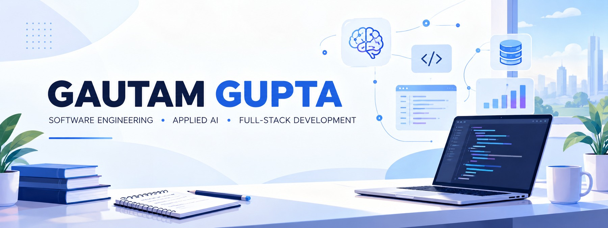
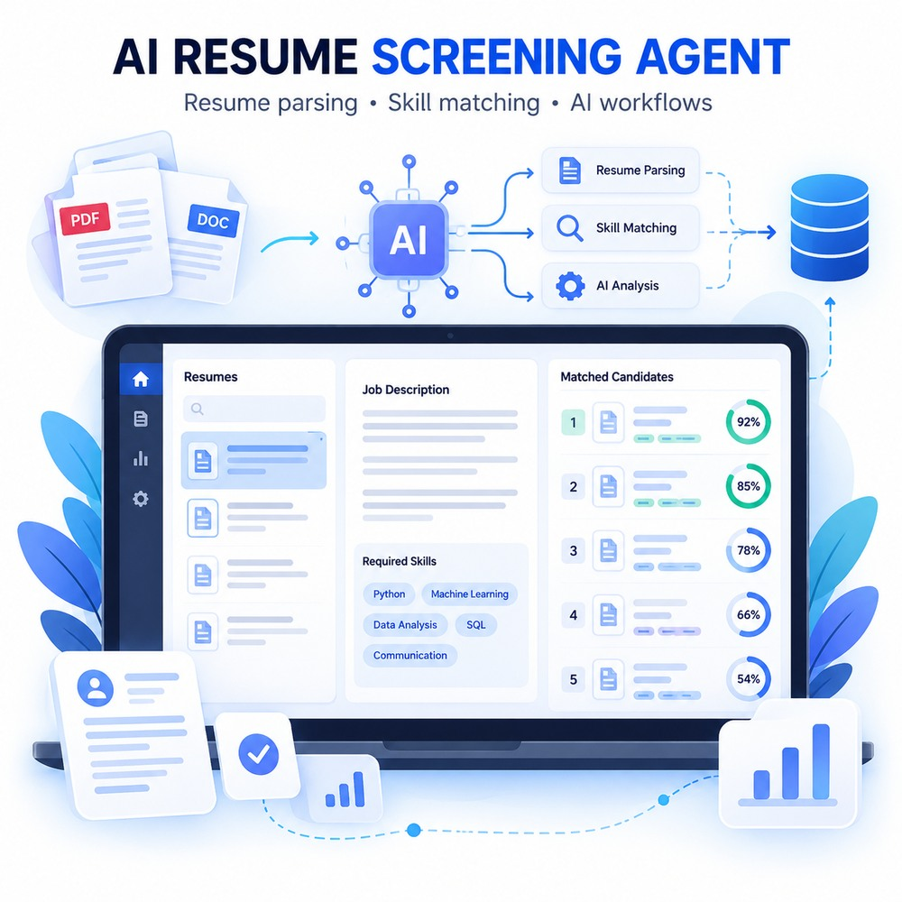

<div align="center">
  

  <p>
    <a href="https://github.com/GTGautam16"></a>
    <a href="https://www.linkedin.com/in/gautam-gupta-it/"></a>
    <a href="mailto:gautam16.work@gmail.com"></a>
  </p>

  <h3>Software Engineering · Applied AI · Full-Stack Development</h3>
  <p>📍 Mumbai, India</p>
</div>

---

## 👨‍💻 About Me

I'm Gautam Gupta, an Information Technology engineering graduate with an Honors specialization in Data Science. I'm interested in building practical software applications, AI-powered workflows, and web solutions that solve real problems.

I like working across the development process—from turning a problem into a clear workflow, to writing application logic, integrating APIs, persisting data, testing behavior, and improving the final user experience.

```text
Problem → Design → Implement → Test → Deploy → Improve
```

## 🚀 Featured Project

<a href="https://github.com/GTGautam16/AI-Resume-Screening-Agent">
  
</a>

### AI Resume Screening Agent

An AI-assisted application focused on analyzing candidate resumes in relation to job requirements. The project explores document processing, model/API integration, structured application workflows, and persistent storage.

**Repository:** [GTGautam16/AI-Resume-Screening-Agent](https://github.com/GTGautam16/AI-Resume-Screening-Agent)

**Technologies used in the project work:**


**Engineering areas:** resume text extraction · job-requirement matching · API integration · data persistence · environment configuration · debugging and testing

> The image above is an original concept illustration made for this profile README, not a screenshot of the running application.

---

## 🧰 Technical Toolkit

### Languages


### Web Development


### AI & Data


### Databases, Tools & Deployment


## 📚 Currently Improving

- **AI Engineering:** reliable LLM-powered workflows, structured outputs, and API integration
- **Backend Engineering:** REST API design, input validation, configuration, and error handling
- **Database Engineering:** relational modeling, SQL, and PostgreSQL integration
- **Software Quality:** debugging, test design, and maintainable code
- **Application Delivery:** deployment, secrets management, and production-readiness fundamentals

## 📊 GitHub Activity

<div align="center">
  
  
  
  
</div>

## 🎓 Education

**B.E. in Information Technology** · KC College of Engineering and Management Studies and Research  
**Honors specialization:** Data Science · Mumbai University · 2022–2026

---

## 🤝 Connect With Me

- **LinkedIn:** [gautam-gupta-it](https://www.linkedin.com/in/gautam-gupta-it/)
- **GitHub:** [@GTGautam16](https://github.com/GTGautam16)
- **Email:** [gautam16.work@gmail.com](mailto:gautam16.work@gmail.com)

<div align="center">
  <sub>Build thoughtfully. Learn continuously. Ship useful things. 🚀</sub>
</div>
